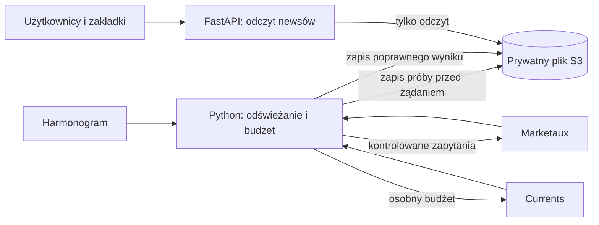

# Wspólny cache i budżet zapytań dla Financial news

Data: 8 listopada 2026. Zadanie: LL-049 — projekt przed wdrożeniem AWS.
Status: propozycja do implementacji w osobnym zadaniu. Ten dokument nie oznacza
utworzenia zasobów, zmiany uprawnień ani gotowości obecnego kodu do produkcji.

## Cel i obecny stan

Każda zakładka i każdy użytkownik mają czytać wspólnie zapisane wiadomości.
Ruch na stronie nie może uruchamiać pobierania od dostawcy. Wyłączenie newsów
lub awaria dostawcy nie mogą blokować kalkulatora ani pozostałej strony.

Obecny `backend/app/news.py` obsługuje Marketaux i Currents. Każdy ma sześciogodzinny
cache, osobną blokadę procesu, rejestr prób w kroczącym oknie 24 godzin i przerwę
po błędzie. Wyniki są łączone bez powtórzeń tych samych URL (pomijając fragment),
a awaria jednego źródła nie blokuje drugiego. Limity lokalne: Marketaux 80 prób,
Currents 200 prób. Dane, liczniki i blokady nadal żyją w pamięci procesu;
restart je usuwa, a instancje Lambdy mają osobne kopie. W obecnym widoku dwa
źródła to zwykle do 8 zapytań na dobę przy ciągłej pracy jednego procesu
(4 Marketaux + 4 Currents), niezależnie od liczby kart i odwiedzin. Nie jest to
gwarancja dla restartów ani wielu procesów. API zwraca listę z polem
`provider`, ale nie zwraca jeszcze daty pobrania ani stanu starszych danych.
Poniższa architektura trwałego cache pozostaje projektem, nie wdrożonym kodem.

Zadanie dotyczy istniejących newsów; nie rozpoczyna innych modułów produktu.
Nie zmieniamy zasad obliczeń kredytu ani nie dodajemy bazy danych.

## Decyzja architektoniczna

Proponowany zestaw do późniejszego wdrożenia:

- Jeden mały, prywatny bucket S3 na stan newsów, oddzielony od hostingu UI.
- Jeden obiekt `news/state-v1.json`: aktualne zestawy, daty i rejestr prób.
- Jedna funkcja Python Lambda odświeżająca wiadomości, bez publicznego URL.
- Jeden harmonogram EventBridge Scheduler, na start co 6 godzin w UTC.
- Istniejący backend FastAPI czyta S3; jego endpoint newsów nie posiada klucza
  żadnego dostawcy i nie ma ścieżki awaryjnej pobierającej dane od dostawców.



S3 służy do przechowania małego pliku JSON. Nie potrzebujemy Redis, DynamoDB,
RDS ani VPC. Sam CloudFront lub cache w pamięci nie zapewniają trwałego,
wspólnego licznika prób. S3 obsługuje zapisy warunkowe, potrzebne do uniknięcia
nadpisania stanu przez drugi proces [3]. Wariant z odświeżaniem wywoływanym
przez wizytę użytkownika odrzucamy: niepotrzebnie łączy ruch z limitem dostawcy.

Bucket nie będzie źródłem publicznym CloudFront. Backend dostaje wyłącznie
odczyt konkretnego obiektu; funkcja odświeżająca odczyt i zapis. To projekt
przyszłych uprawnień, nie ich nadanie w tym zadaniu. Klucze obu dostawców pozostają
w konfiguracji funkcji odświeżającej, poza JSON, frontendem i logami.

## Budżety dostawców

### Marketaux

Publiczny plan Free Marketaux: 100 zapytań dziennie i do 3 artykułów na
zapytanie [1]. Faktyczny plan konta, wykorzystanie i moment resetu wymagają
potwierdzenia w panelu. Nie zakładamy, że reset następuje o północy UTC.

Jedna kategoria to jeden skonfigurowany zestaw filtrów. Kilka zakładek może
wyświetlać ten sam zestaw bez dodatkowego pobrania. Filtry użytkownika nie
mogą tworzyć nowych zapytań do dostawcy. Język, dodatkowa strona wyników lub
inny zestaw filtrów oznaczają osobne zapytania i muszą być ujęte w budżecie.

Wzór planowania: liczba zestawów × odświeżenia na dobę × strony wyników.

| Wariant | Zestawy | Interwał | Strony | Planowane zapytania/dobę |
| --- | ---: | ---: | ---: | ---: |
| Start: obecne ogólne wiadomości | 1 | 6 godzin | 1 | 4 |
| Rozszerzenie do czterech kategorii | 4 | 6 godzin | 1 | 16 |
| Przykład dziesięciu kategorii | 10 | 6 godzin | 1 | 40 |
| Niedopuszczalna konfiguracja | 10 | 2 godziny | 1 | 120 |

Na start pozostaje jedna istniejąca kategoria `overview`, język `en`, limit 3,
bez paginacji. Dalsze kategorie wymagają osobnego uzgodnienia filtrów i potrzeb.
Maksymalnie 10 skonfigurowanych zestawów w tej wersji projektu.

Reguły wspólne dla jednego klucza Marketaux:

1. Każdy zestaw odświeżamy nie częściej niż co 6 godzin. Także po błędzie
   następna próba następuje najwcześniej po 6 godzinach (lub później według
   `Retry-After`). Konfiguracja może planować najwyżej 60 zapytań na dobę.
2. Twardy limit: 80 zarezerwowanych prób w dowolnych ostatnich 24 godzinach.
   Kroczące okno unika zależności od niepotwierdzonej godziny resetu dostawcy.
3. Każde żądanie HTTP rezerwuje jednostkę PRZED połączeniem. Timeout, błąd,
   pusta odpowiedź i przerwanie procesu nie zwracają tej jednostki do puli.
4. Pozostałe 20 zapytań względem planu Free to margines, a nie pula publiczna.
   Nie wolno zakładać, że błędne żądania są bezpłatne dla limitu.
5. Po 60 próbach w oknie zapisujemy ostrzeżenie; przy 80 zatrzymujemy pobieranie.
   Następny termin wynika z wygaśnięcia najstarszej rezerwacji.
6. Każdy ręczny refresh korzysta z tego samego licznika. Nie ma publicznego
   endpointu „force refresh”. Zwykłe ponowne wdrożenie nie inicjalizuje licznika.
7. Inna aplikacja używająca tego samego klucza może wyczerpać limit poza naszym
   licznikiem. Limit 80 gwarantuje tylko budżet wywołań przechodzących przez
   ten mechanizm, nie dostępność dostawcy ani całego konta.

### Currents i zasady korzystania z dwóch źródeł

Currents Free: 250 zapytań dziennie, do 20 artykułów na zapytanie; reset o 00:00
UTC [9–11]. Proponowany budżet planowy: najwyżej 150/dobę; twardy limit
rezerwacji 200 w ostatnich 24 godzinach. To osobny licznik od Marketaux.
Dwa plany nie tworzą jednej wymiennej puli: wyczerpane 100 Marketaux nie może
zostać odtworzone zapytaniem do Currents o dane Marketaux.

Przykładowy przyszły podział 12 kategorii odświeżanych co 6 godzin:
4 zestawy Marketaux × 4 = 16 oraz 8 zestawów Currents × 4 = 32 zapytania/dobę.
To model do uzgodnienia, nie utworzone zakładki. Wymaga rozszerzenia początkowego
limitu 10 zestawów oraz ponownego doboru timeoutu zadania. Mapowanie filtrów
jest osobne: Currents V2 używa np. `economy_business_finance`,
`science_technology` i `real_estate`; nie przekazujemy tych nazw do Marketaux.

Aktualna integracja dotyczy jednego widoku Financial news:
- Marketaux: dotychczasowe newsy finansowe, do 3 artykułów.
- Currents: `/v2/latest-news`, `language=en`,
  `category=economy_business_finance`, `page_size=20`, bez paginacji.
- Jeśli są oba klucze, backend pobiera je równolegle i łączy wyniki (do 23 kart
  przed usunięciem powtórzeń). Sama awaria nie uruchamia dodatkowego requestu.
- Każdy dostawca ma osobny cache, licznik i termin ponowienia; brak klucza
  jednego dostawcy nie blokuje drugiego. Brak obu kluczy daje 503.
- Na karcie pozostaje oryginalny wydawca i link, z dopiskiem `via Currents`
  lub `via Marketaux`. Ten sam URL ma jedną kartę; nie łączymy różnych URL
  wyłącznie na podstawie podobnego tytułu.

W docelowym pliku S3 `attempts`, `provider_blocked_until`, `provider_disabled`
i `last_error_code` trzeba umieścić pod `providers[provider_id]`. Rezerwacja
zawiera również identyfikator dostawcy. Zestaw artykułów zachowuje pole
`provider` przy każdej pozycji. Wszystkie rezerwacje i zmiany zestawów nadal
korzystają z jednego obiektu oraz warunkowych zapisów ETag.

HTTP 429 Currents może oznaczać limit dzienny lub chwilowy; wykorzystujemy
`Retry-After`, a przy wyczerpaniu dziennym reset 00:00 UTC. Nie interpretujemy go
jako minutowego błędu Marketaux. Obecna implementacja respektuje liczbowy
`Retry-After` (sekundy), stosując minimum sześciogodzinną przerwę; bez poprawnego
nagłówka ponawia najwcześniej za sześć godzin. Pełna polityka harmonogramu pozostaje
częścią przyszłej implementacji trwałego cache.

Klucz `CURRENTS_API_KEY` dopisuje się do lokalnego `backend/.env`. Wymagany jest
bezpłatny plan; nie aktywujemy płatnych planów ani triali wymagających karty.
Ta integracja nie rejestruje konta i nie tworzy klucza za użytkownika.

## Stan i bezpieczne odświeżanie

Jeden walidowany JSON zawiera:

| Pole | Znaczenie |
| --- | --- |
| `schema_version` | Wersja formatu; początkowo 1 |
| `feeds` | Mapa dozwolonych identyfikatorów zestawów |
| `feeds[id].articles` | Ostatni poprawnie pobrany zestaw, także poprawna pusta lista |
| `feeds[id].fetched_at` | Czas pobrania w UTC, odrębny od dat publikacji artykułów |
| `feeds[id].fresh_until` | Pobranie + interwał + 5 minut tolerancji harmonogramu |
| `feeds[id].serve_until` | Pobranie + maksymalnie 24 godziny |
| `feeds[id].last_attempt_slot` | Identyfikator ostatnio zarezerwowanego okna harmonogramu |
| `attempts` | Rezerwacje z ostatnich 24 godzin: czas, zestaw, identyfikator okna |
| `provider_blocked_until` | Wspólny termin ponowienia po limicie dostawcy |
| `provider_disabled` | Trwałe zatrzymanie po 401/403, zdejmowane po korekcie konfiguracji |
| `last_error_code` | Bezpieczny kod diagnostyczny bez odpowiedzi dostawcy i kluczy |

Zapisujemy tylko pola artykułów potrzebne istniejącym kartom, bez pełnej treści
artykułów i bez kopii plików obrazów. Limit całego obiektu: 1 MiB; zbyt duża lub
nieprawidłowa odpowiedź nie zastępuje poprawnego zestawu. Dane artykułów starsze
niż `serve_until` są usuwane przy następnym zapisie. Licznik nie zawiera treści.

Algorytm przyszłej funkcji odświeżającej:

1. Odczytaj i zwaliduj stan z S3 wraz z ETag. Przy niedostępności/uszkodzeniu
   stanu zatrzymaj zadanie BEZ wywołania Marketaux. Brak obiektu po uruchomieniu
   produkcji nie oznacza nowego konta ani zgody na wyzerowanie budżetu.
2. Przyjmuj tylko identyfikatory z konfiguracji. Zdarzenie zawiera planowany
   czas; opóźnione o ponad 5 minut lub powtórzone okna pomijaj. Nie nadrabiaj
   wszystkich pominiętych odświeżeń po przerwie.
3. Sprawdź blokadę dostawcy, interwał i limit globalny. Przetwarzaj kolejno
   zestawy, zaczynając od najdłużej nieodświeżanego, aby nie zagłodzić końca listy.
4. Zapisz rezerwację jednostki i identyfikator okna przez `PutObject If-Match`
   z odczytanym ETag. Przy konflikcie odczytaj ponownie; przy błędzie/niepewnym
   wyniku zapisu zakończ bez HTTP. Sama blokada procesu nie wystarcza.
5. Wykonaj jedno żądanie Marketaux z timeoutem 10 sekund, bez automatycznych
   ponowień i bez automatycznego podążania za przekierowaniami. Kolejny request
   zawsze wymaga nowej rezerwacji. Respektuj limit minutowy dostawcy; dla
   planowanych maksymalnie 10 zestawów pobieraj sekwencyjnie. Weryfikacja
   aktualnego limitu minutowego jest warunkiem wdrożenia.
6. Zwaliduj całą odpowiedź. Dopiero poprawny wynik atomowo zastępuje zestaw
   w tym samym obiekcie; inne zestawy i rejestr prób pozostają zachowane.
   Zapis wyniku również wymaga aktualnego ETag. Konflikt nie pozwala na
   nadpisanie nowszego stanu ani ponowienie żądania do dostawcy.
7. Przy awarii po rezerwacji jednostka pozostaje zużyta, a stare artykuły
   pozostają dostępne. Tracimy co najwyżej jedno odświeżenie, nie kontrolę limitu.

Jeden proces zapisujący: osobna Lambda z reserved concurrency 1. To upraszcza
kolejność, ale nie zastępuje rezerwacji i deduplikacji. Scheduler i asynchroniczna
Lambda mają osobne mechanizmy ponowień [4]; w przyszłej konfiguracji wyłączamy
ponowienia błędów funkcji i dostarczania, ograniczamy wiek zdarzenia, a mimo to
obsługujemy duplikaty przez identyfikatory okien. Timeout zadania należy dobrać
do liczby zestawów; początkowy limit 150 sekund dla maksymalnie 10 zestawów.

Pierwsze utworzenie stanu przez `If-None-Match: *` jest osobną czynnością
uruchomieniową. Po używaniu klucza poza mechanizmem trzeba najpierw potwierdzić
odnowienie limitu lub odczekać pełne 24 godziny bez innych wywołań. Nie usuwamy
stanu ani rezerwacji, aby „naprawić” osiągnięty limit. Aktualizacja schematu
musi zachować licznik i blokadę.

## Zachowanie podczas awarii

| Zdarzenie | Odświeżanie | Widok użytkownika |
| --- | --- | --- |
| Poprawne dane, także `[]` | Zapisz nowy zestaw i datę pobrania | Dane lub „No headlines available right now.” |
| HTTP 402 `usage_limit_reached` | Blokada całego dostawcy na 24 godziny od błędu, potem pojedyncza próba w następnym oknie | Ostatnie dostępne dane z datą |
| HTTP 429, limit minutowy | Respektuj poprawne `Retry-After`, bez nagłówka przerwa 6 godzin; wznowienie dopiero w kolejnym dozwolonym oknie | Ostatnie dostępne dane z datą |
| Timeout, HTTP 5xx, błędny JSON | Zachowaj dane; kolejna próba w następnym oknie | Ostatnie dostępne dane z datą |
| HTTP 401/403 | Zablokuj automatyczne pobieranie do korekty konfiguracji | Dane do upływu okresu dostępności |
| Brak pierwszego zestawu / dane starsze niż 24 h | Żądanie użytkownika niczego nie odświeża | Czytelna informacja o niedostępności |
| Niedostępność S3 | Bez wywołania Marketaux | Zweryfikowana kopia lokalna do 24 h albo niedostępność |

402 oznacza limit wykorzystania planu, 429 limit w ostatnich 60 sekundach [2].
Blokada na 24 godziny jest naszą ostrożną polityką; nie deklaracją czasu resetu
konta. Rezerwacje obowiązują niezależnie od rodzaju błędu.

## Docelowy kontrakt i interfejs

Zmiana kontraktu jest zaplanowana, jeszcze NIE zaimplementowana. Backend i
frontend trzeba zmienić razem. Endpoint: `GET /api/v1/news?feed=overview`.
Brak parametru oznacza `overview`; nieznany identyfikator zwraca 422.

```json
{
  "articles": [],
  "feed": "overview",
  "fetched_at": "2026-11-08T12:00:00Z",
  "fresh_until": "2026-11-08T18:05:00Z",
  "serve_until": "2026-11-09T12:00:00Z",
  "stale": false
}
```

- 200: istnieje poprawny zestaw, również pusty. `stale` obliczane z aktualnego
  czasu, a nie zapisywane raz na zawsze w obiekcie. Daty w UTC, prezentacja
  w lokalnym czasie użytkownika. Starsze dostępne dane: „Showing saved news.
  Last updated …”. Nie nazywamy ich wiadomościami w czasie rzeczywistym.
- 503: brak użytecznego zestawu lub wygasł `serve_until`; ogólny komunikat i
  `Retry-After` wyliczony z następnego dozwolonego okna. Przy braku konfiguracji
  używamy odrębnego kodu `news_not_configured`, nie samego statusu HTTP.
- Odczyt nie ujawnia licznika, błędów dostawcy ani klucza. Brak API odświeżania.
- Backend może użyć kopii w pamięci na 60 sekund, wspólnej dla wszystkich
  żądań w danym procesie, ale źródłem jest S3. Zawsze przelicza aktualność.
- Początkowo `Cache-Control: no-store` na odpowiedzi API; CloudFront obsługuje
  frontend. Cache odpowiedzi HTTP/CDN to osobna optymalizacja, nie mechanizm
  ochrony limitu. Dzięki temu termin 24 godzin nie jest wydłużany przez CDN.

## Praca lokalna i obserwacja

Domyślny tryb przyszłej implementacji: lokalny plik z syntetycznymi nagłówkami,
z widocznym oznaczeniem „Demo news”. Nie łączymy się z Marketaux w testach,
przy starcie Vite, restarcie Uvicorn ani odświeżaniu zakładek. Tryb live będzie
osobnym, świadomym uruchomieniem przez ten sam mechanizm rezerwacji. Nie
udostępniamy produkcyjnego klucza lokalnym procesom pomijającym licznik.

W logach operacyjnych: czas odświeżenia, identyfikator zestawu, liczba rezerwacji,
bezpieczny kod błędu i wiek danych. Bez URL z tokenem, pełnych odpowiedzi i treści
artykułów. Kontrola: wykorzystanie ≥60/80, 402/401/403, brak odświeżenia przez
dwa interwały, konflikty zapisu i niedostępność S3. Publiczny endpoint nadal
może generować koszty AWS; budżet Marketaux nie jest limitem rachunku AWS.

## Skala i koszty do potwierdzenia przed wdrożeniem

Dla 4 zestawów co 6 godzin i miesiąca 31 dni:

- 16 × 31 = 496 prób Marketaux przy pełnym harmonogramie, po 3 artykuły.
- 4 × 31 = 124 planowane uruchomienia zadania.
- Około 2 × 496 = 992 zapisów stanu S3 (rezerwacja i wynik), plus zapisy
  blokad/porządkowania oraz odczyty zadania i publicznego API.
- Stan ≤1 MiB, bez archiwum artykułów. Liczba odczytów publicznych zależy od
  ruchu i liczby instancji; nie jest ograniczona budżetem zapytań Marketaux.

To model wolumenu, nie wycena w funtach. Przed wdrożeniem policzyć S3
(przechowywanie, GET/PUT), Lambda (wywołania i czas), Scheduler, CloudWatch
oraz transfer i hosting UI dla wybranego regionu i planu konta [5–7]. Nie
zakładamy automatycznie Free Tier. Cel projektu £0–£5/miesiąc pozostaje celem,
a alert AWS Budgets nie odcina automatycznie kosztów. Nie tworzymy tutaj
żadnego z wymienionych zasobów ani nie dodajemy zależności AWS do aplikacji.

## Warunki publikacji i późniejsze testy

Przed publicznym użyciem potwierdzić prawa do wyświetlania nagłówków, obrazów,
przechowywania przez 24 godziny i obsługi wielu użytkowników. Ogólne warunki
Marketaux zawierają ograniczenia użycia treści; sam cennik Free nie potwierdza
wszystkich tych uprawnień [8]. Do wyjaśnienia zakresu stosować dane demo lub
pozostawić dane danego dostawcy wyłączone na produkcji. Currents deklaruje
użycie komercyjne z atrybucją i linkami, lecz długoterminowe przechowywanie,
archiwizacja i ponowna publikacja treści mają osobne warunki [9]. Zakres
24-godzinnego cache i użycia obrazów potwierdzić osobno dla obu dostawców.
Nie kopiować pełnych artykułów.

Kryteria akceptacji przyszłej implementacji:

1. 1000 odczytów, różne zakładki i restart API: zero żądań do dostawcy.
2. Restart zadania zachowuje licznik, daty, blokadę i ostatni zestaw.
3. Duplikat zdarzenia i równoległe wywołania: najwyżej jedna próba na zestaw/okno.
4. 80 rezerwacji w ostatnich 24 h: kolejna próba zablokowana; jednostka wraca
   dopiero po wyjściu rezerwacji z okna, także przy zmianie daty i czasu letniego.
5. Timeout/przerwanie po rezerwacji nie oddają jednostki. Nieudany zapis
   rezerwacji uniemożliwia HTTP; konflikt zapisu wyniku nie nadpisuje nowszych danych.
6. 402 i 429 mają odrębne blokady; ponowne wdrożenie ich nie resetuje.
7. Starsze dane pokazują datę i ostrzeżenie; powyżej 24 h nie są wyświetlane.
8. Brak danych, poprawne `[]`, błędne dane i niedostępność storage mają osobne testy.
9. Nadmierna liczba zestawów, paginacja, nieznane filtry i plan >60/dobę odrzucone.
10. Domyślne uruchomienie lokalne i wszystkie testy nie wykonują połączeń z Marketaux.

Kolejne osobne zadanie: lokalna implementacja formatu zestawu z metadanymi,
repozytorium plikowego, kontrolowanego odświeżania i licznika z testami. Adapter
S3 i harmonogram AWS powstaną dopiero w osobno uzgodnionym etapie infrastruktury.

## Źródła

Sprawdzone 8 listopada 2026; przed wdrożeniem ponownie zweryfikować warunki i ceny.

1. [Marketaux — Pricing](https://www.marketaux.com/pricing)
2. [Marketaux — Documentation: błędy i parametry API](https://www.marketaux.com/documentation)
3. [AWS S3 — Conditional writes](https://docs.aws.amazon.com/AmazonS3/latest/userguide/conditional-writes.html)
4. [AWS Lambda — Asynchronous invocation metrics and retries](https://aws.amazon.com/blogs/compute/introducing-new-asynchronous-invocation-metrics-for-aws-lambda/)
5. [AWS S3 — Pricing](https://aws.amazon.com/s3/pricing/)
6. [AWS Lambda — Pricing](https://aws.amazon.com/lambda/pricing/)
7. [AWS EventBridge — Pricing](https://aws.amazon.com/eventbridge/pricing/)
8. [Marketaux — Terms of Service](https://www.marketaux.com/tos)

9. [Currents — Pricing](https://currentsapi.services/en/product/price)
10. [Currents — Latest News i kategorie V2](https://currentsapi.services/en/docs/latest_news)
11. [Currents — Rate limits](https://currentsapi.services/en/docs/ratelimit)
